# Aplikasi Presensi Siswa Berbasis RFID (SMK TI Airlangga Samarinda)

Aplikasi web berbasis PHP Native (OOP & PDO) dan database MariaDB untuk mencatat dan merekap kehadiran siswa melalui pembacaan kartu RFID (NISN 10 digit) secara real-time.

## Fitur Utama
- **Login & Logout Administrator**: Autentikasi menggunakan `password_hash` dan `password_verify` dengan proteksi `$_SESSION`.
- **Kelola Kelas (CRUD)**: Tambah, tampil, ubah, dan hapus kelas dengan validasi nama kelas unik serta pencegahan hapus jika kelas masih memiliki siswa.
- **Kelola Siswa (CRUD & Pencarian)**: Tambah, tampil (`INNER JOIN` kelas), ubah, hapus, serta pencarian berdasarkan nama atau NISN (validasi 10 digit angka).
- **Simulasi Tap Kartu RFID**: Input 10 digit NISN untuk mencatat kehadiran dengan waktu tap otomatis dari database.
- **Rekap Presensi (`INNER JOIN` 3 Tabel)**: Menampilkan data kehadiran hari ini secara bawaan, filter tanggal dan kelas, pencarian nama/NISN, serta hapus log salah catat.

## Cara Instalasi
1. Salin folder proyek `auukganjil` ke dalam folder web server (`C:\Users\Asus\Desktop\laragon\www\auukganjil`).
2. Jalankan layanan **Apache** dan **MySQL/MariaDB** di Laragon.
3. Buka **phpMyAdmin** (`http://localhost/phpmyadmin`), masuk ke tab **SQL**, lalu jalankan perintah dari file `database/schema.sql` untuk membuat database `auukganjil` beserta tabel-tabelnya.
4. Sesuaikan kredensial database pada `config/database.php` jika diperlukan.
5. Jalankan seeder dengan membuka `http://localhost/auukganjil/database/seeder.php` di browser untuk mengisi akun admin dan data awal kelas.
6. Buka aplikasi di `http://localhost/auukganjil/`.

## Akun Demo Administrator
- **Username**: `admin`
- **Password**: `guru123`

## Gambar ERD (Entity Relationship Diagram)
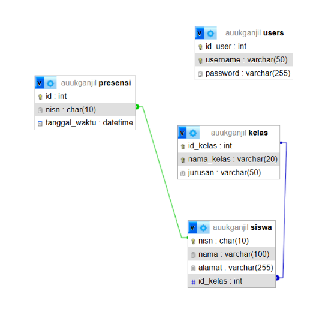

## Tabel Hasil Pengujian
| No | Skenario Uji | Hasil yang Diharapkan | Status | Bukti |
| :- | :--- | :--- | :-: | :--- |
| 1 | Login dengan password salah | Tetap di halaman login, muncul pesan kesalahan | Berhasil | 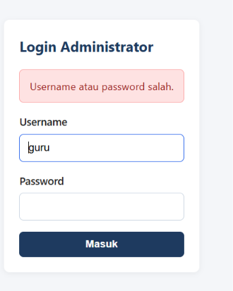 |
| 2 | Buka halaman tanpa login lewat URL langsung | Diarahkan ke halaman login | Berhasil | 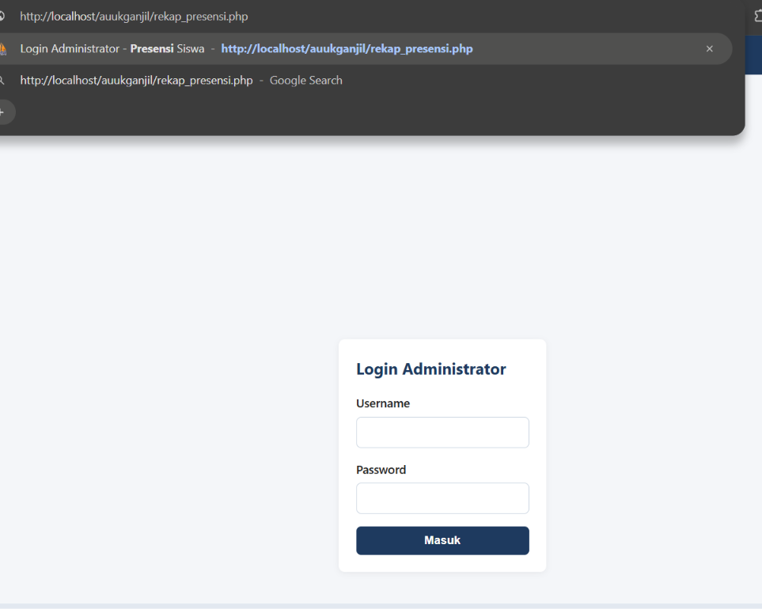 |
| 3 | Tambah siswa dengan NISN 9 digit | Validasi gagal, pesan muncul, isian tidak hilang | Berhasil | 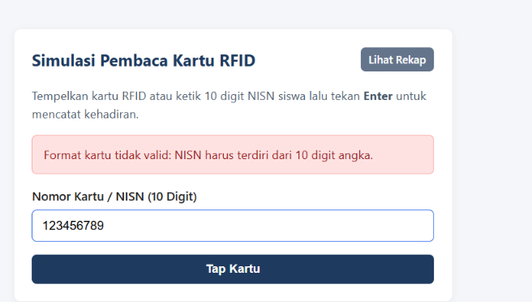 |
| 4 | Tambah siswa dengan NISN yang sudah ada | Ditolak dengan pesan NISN sudah terdaftar | Berhasil | 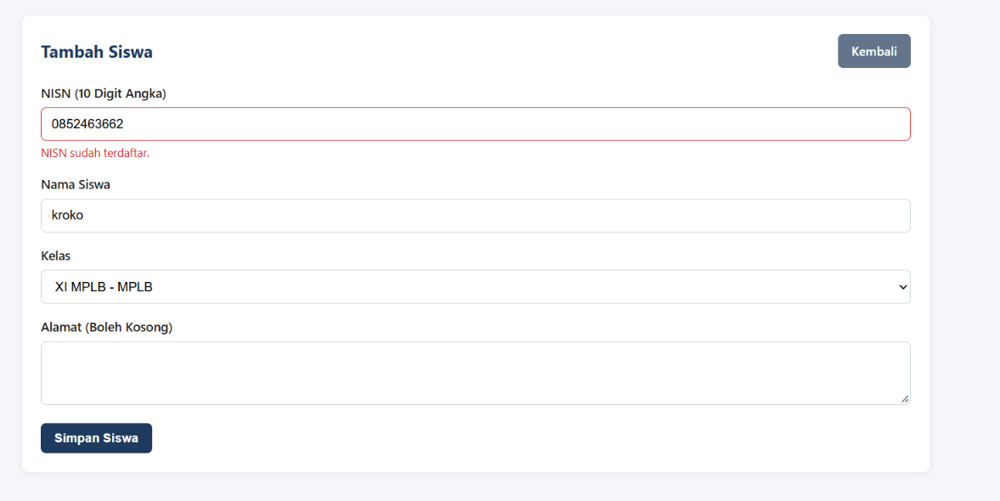 |
| 5 | Simulasi tap dengan NISN yang tidak terdaftar | Ditolak dengan pesan yang jelas | Berhasil | 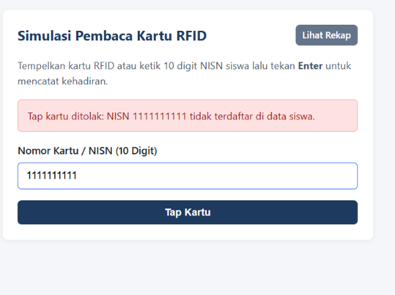 |
| 6 | Simulasi tap dengan NISN valid | Muncul di rekap hari ini, dengan waktu terisi otomatis | Berhasil | 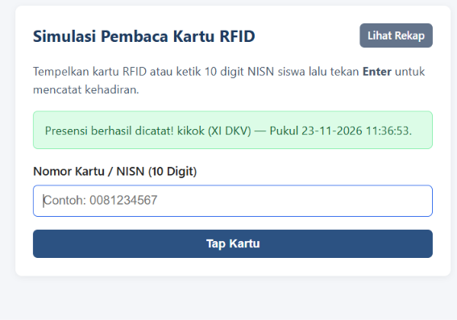 |
| 7 | Hapus kelas yang masih memiliki siswa | Ditolak dengan pesan yang mudah dipahami | Berhasil | 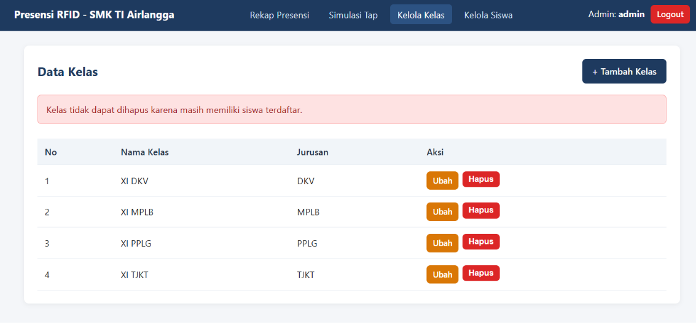 |
| 8 | Cari siswa berdasarkan sebagian nama | Hanya siswa yang sesuai yang tampil | Berhasil | 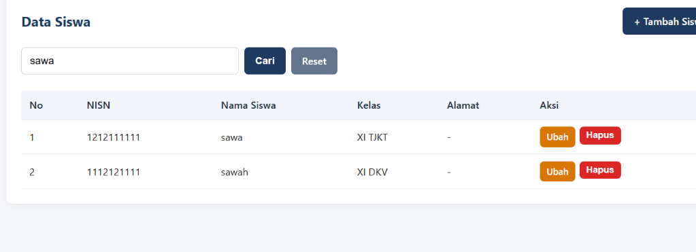 |
| 9 | Uji tampilan aplikasi pada smartphone | Tata letak dan tabel responsif di layar mobile | Berhasil | 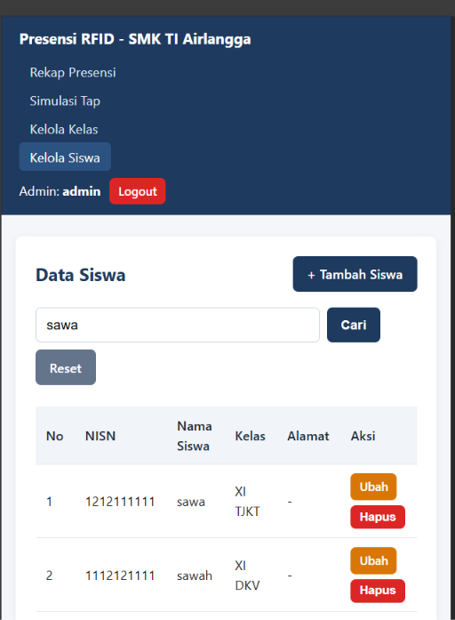 |

## Tangkapan Layar Halaman Utama

### 1. Halaman Login
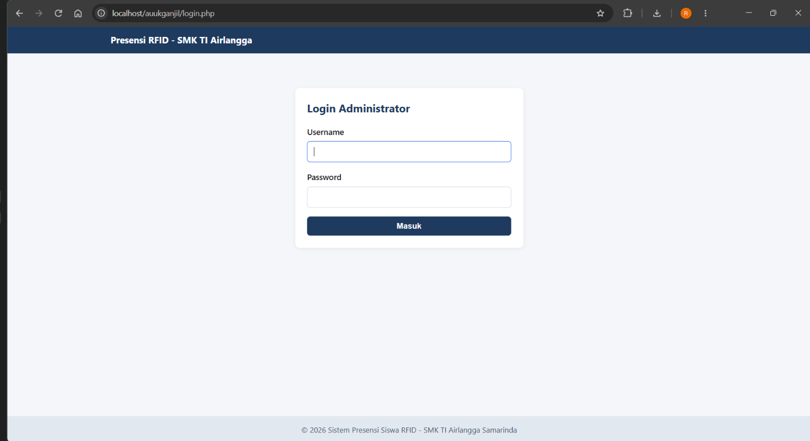

### 2. Halaman Rekap Presensi
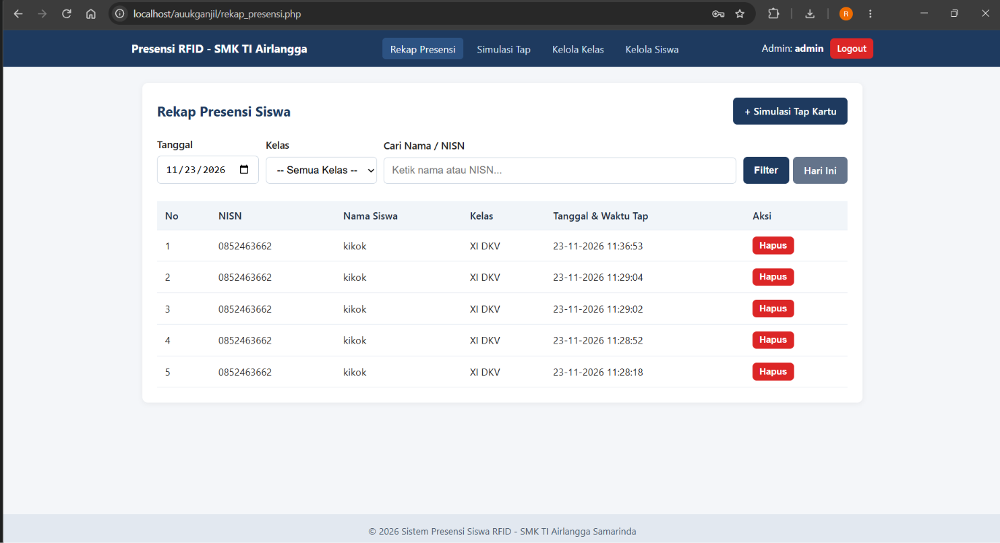

### 3. Halaman Simulasi Tap Kartu
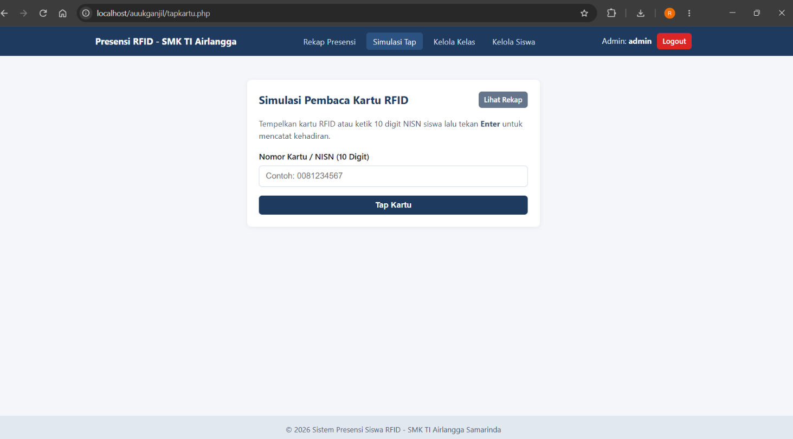

### 4. Halaman Kelola Kelas
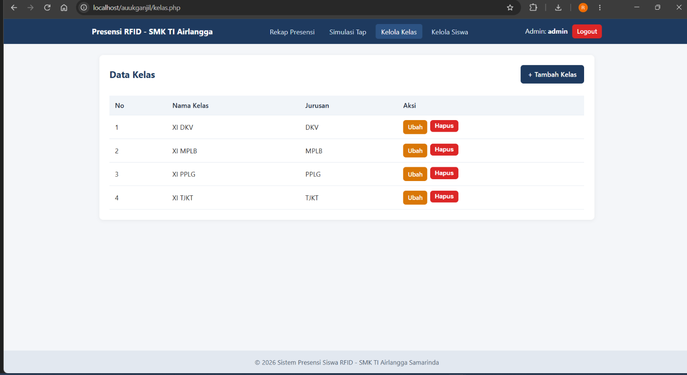

### 5. Halaman Kelola Siswa
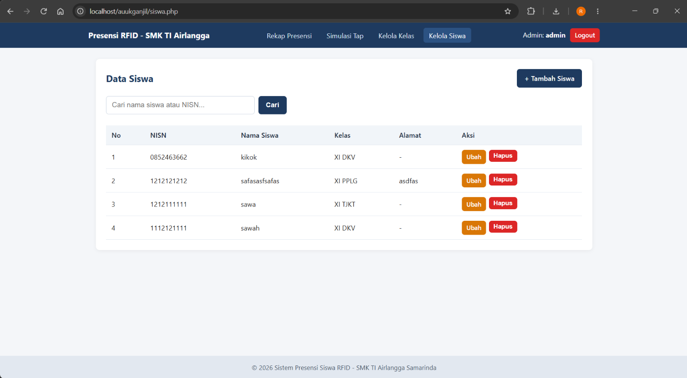